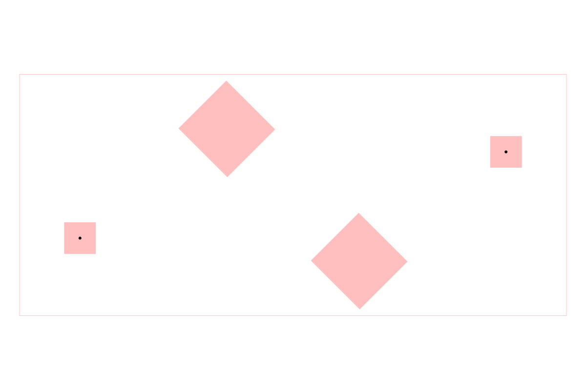

# dataset-srj11-45-degree
45 Degree Autorouting Problem Dataset (validates an autorouter has good 45-degree obstacle support)

This repo is now scaffolded as a regular `tscircuit` project with twenty-six
single-net obstacle samples under `circuits/`. Each sample uses two
endpoint pads and one routed trace, with rotated custom-footprint chips acting
as the blocking geometry.

Current samples:

- `sample001`: wide rising tunnel between two diamond pads
- `sample002`: wide falling tunnel between two diamond pads
- `sample003`: rising tunnel using two-pad diagonal stretches with an about-0.1mm sliver
- `sample004`: falling tunnel mirrored with two-pad diagonal stretches
- `sample005`: asymmetric rising diamond tunnel with a larger entry obstacle
- `sample006`: asymmetric falling diamond tunnel with mirrored obstacle sizes
- `sample007`: wide tunnel between two tilted rectangular pads
- `sample008`: mirrored tilted-pad tunnel
- `sample009`: two diamond tunnels in sequence
- `sample010`: narrower rising tunnel between two tilted rectangular pads
- `sample011`: ten-obstacle horizontal weave with blockers across the centerline
- `sample012`: ten-obstacle rising diagonal weave with scattered blockers on the route
- `sample013`: ten-obstacle falling diagonal weave through alternating blockers
- `sample014`: ten-obstacle broken fence that forces repeated gap selection
- `sample015`: ten-obstacle shelf field with blockers forcing alternating side escapes
- `sample016`: ten-obstacle island cluster threaded through alternating openings
- `sample017`: ten-tooth comb maze with alternating 45-degree sliver gates
- `sample018`: ten-obstacle guarded ring aperture with sentries in the corridor
- `sample019`: ten-obstacle asymmetric scatter field blocking a diagonal net
- `sample020`: ten-obstacle zigzag maze with blockers placed in every corridor segment
- `sample021`: single-obstacle rising slot with rotated rectangular endpoints
- `sample022`: two-obstacle rising slot with rotated rectangular endpoints
- `sample023`: three-obstacle rising slot with a wider central passage
- `sample024`: four-obstacle rising slot with alternating rotated rectangular blockers
- `sample025`: five-obstacle rising slot with both endpoints inside rotated rectangular pads
- `sample026`: six-obstacle falling slot with both route endpoints centered in rotated rectangles

## Example

The image below shows `sample001`. It is generated by constructing an
`AutoroutingPipelineSolver`, calling `.visualize()`, and passing the resulting
graphics object to `graphics-debug`'s SVG converter.

Regenerate it with `bun run generate:readme-image`.

## Dataset browser

Run `bun run cosmos` locally. `bun run build:site` writes the deployable static
catalog to `cosmos-export/` for Vercel.

Usage:

- `bun install`
- `bun run build`
- `tsci build circuits/sample001.circuit.tsx`
